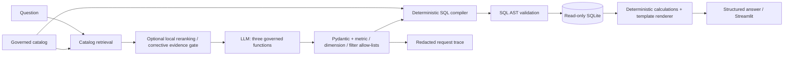

# Natural-Language Metrics Service

Ask governed business questions about a reproducible synthetic E-commerce
warehouse without letting a language model write SQL. Responses include outcome,
value, metric definition, SQL and trace ID. Start with [docs](docs/README.md).



Five modes: lookup, naive (dense), hybrid (RRF), hybrid_rerank and corrective.
Retrieval searches catalog text, never warehouse rows. Local embeddings remove
embedding API costs; interactive selection and answer templates still require
an OpenAI key. The offline demo/evaluation instead use explicitly labelled oracle
arguments and make no paid calls.

## Windows setup (PowerShell)

Use Python 3.11+; the verified platform is Windows/Python 3.14.3.
Run from the repository root:

```powershell
python -m venv .venv
.\.venv\Scripts\python.exe -m pip install -r requirements-lock.txt
# Direct test/runtime pins: requirements-dev.txt / requirements.txt.
if (-not (Test-Path .env)) { Copy-Item .env.example .env }
.\.venv\Scripts\python.exe scripts/init_db.py
.\.venv\Scripts\python.exe -m streamlit run ui/streamlit_app.py --server.port 8501
```

Open http://localhost:8501. The title, question box and mode selector render
before model loading. Initialization runs under a spinner with safe terminal
progress. The generator refuses to overwrite an existing database; skip init if
already present, or pass `--path` for a separate snapshot.

The initial installation is large because sentence-transformers includes
**PyTorch**. Local embedding and cross-encoder weights download on first use and
need internet once; subsequent runs reuse the cache. They are separate downloads
from pip. No model download is needed for tests or the lookup oracle demo.

## Configuration

[.env.example](.env.example) deliberately contains blank assignments only.
Populate your own ignored .env; never commit it. Environment values take precedence.
Set external cache locations before using dense/reranked modes; this keeps weights
and caches outside the checkout:

```powershell
$env:MODEL_CACHE_DIR = Join-Path $env:LOCALAPPDATA 'nl-metrics\models'
$env:EMBEDDING_CACHE_DIR = Join-Path $env:LOCALAPPDATA 'nl-metrics\embeddings'
$env:LLM_CACHE_DIR = Join-Path $env:LOCALAPPDATA 'nl-metrics\llm'
$env:TRACE_DIR = Join-Path $env:LOCALAPPDATA 'nl-metrics\traces'
```

| Exact variable | Meaning / default when blank |
|---|---|
| OPENAI_API_KEY | Required only for interactive/live selection and templates |
| OPENAI_MODEL | Model your project can access; default gpt-4.1-mini |
| EMBEDDING_PROVIDER | local (default) or openai |
| OPENAI_EMBEDDING_MODEL | Shared model-name setting; local default sentence-transformers/all-MiniLM-L6-v2 |
| RAG_MODE | hybrid by default; five modes above |
| SQLITE_PATH | data/ecommerce.db; absolute paths also supported |
| AS_OF_DATE | Must equal frozen snapshot date 2026-11-01; blank uses it |
| MODEL_PRICES_JSON | Per-model input/output/cached-input USD per million tokens; no assumed prices |
| RERANK_MODEL / RERANK_ENABLED | cross-encoder/ms-marco-MiniLM-L6-v2 / true |
| MODEL_CACHE_DIR / EMBEDDING_CACHE_DIR | External weight / embedding-cache directories |
| LLM_CACHE_DIR / TRACE_DIR | External response-cache / trace directories |
| SESSION_RATE_LIMIT / SESSION_RATE_WINDOW_SECONDS | 5 submissions / 60 seconds |
| MAX_LLM_CALLS / MAX_OUTPUT_TOKENS / REQUEST_TIMEOUT | 4 / 6000 / 120 seconds |

Additional bounded controls are documented in [.env.example](.env.example) and
[config](app/config.py). Row/query caps are 100 rows / 3 seconds by default.
Restart Streamlit after editing configuration. An unavailable provider fails
explicitly; no silent fallback.

## Commands and demo

```powershell
.\scripts\run.ps1 init-db
.\scripts\run.ps1 run
.\scripts\run.ps1 test
.\scripts\run.ps1 eval   # offline DEV lookup; zero API calls
.\scripts\run.ps1 demo   # eight offline examples, one complete trace

.\.venv\Scripts\python.exe -m pytest -q
.\.venv\Scripts\python.exe scripts/evaluate.py --mode lookup
# All five modes need downloaded local weights:
.\.venv\Scripts\python.exe scripts/evaluate.py --mode all
```

Examples: "What is our net revenue?", "Net revenue by brand",
"What is our conversion rate?", "Revenue in the previous quarter" (clarify),
"Show customer acquisition cost" (refuse), and
"Net revenue for quarter 2020-Q2" (empty_result).
See [eight-question demo and trace](docs/demo.md).

Evaluation defaults to DEV and cached/oracle replay. It is not live accuracy.
Never add `--live` without explicit budget approval. Locked evaluation requires
`--split test --allow-locked-test`; the handoff run has already consumed this
holdout, so do not tune on it or rerun it during normal development.

## macOS / Linux

```sh
python3 -m venv .venv
.venv/bin/python -m pip install -r requirements-dev.txt
test -f .env || cp .env.example .env
export MODEL_CACHE_DIR="$HOME/.cache/nl-metrics/models"
export EMBEDDING_CACHE_DIR="$HOME/.cache/nl-metrics/embeddings"
export LLM_CACHE_DIR="$HOME/.cache/nl-metrics/llm"
export TRACE_DIR="$HOME/.cache/nl-metrics/traces"
.venv/bin/python scripts/init_db.py
.venv/bin/python -m streamlit run ui/streamlit_app.py --server.port 8501
.venv/bin/python -m pytest -q
.venv/bin/python scripts/evaluate.py --mode lookup
```

Direct requirements are portable pins; the full lock records Windows resolution.
macOS/Linux and Python 3.11-3.13 are not verified.

## Results and limitations

The [final metrics table and clean-install record](docs/handoff.md) separate
DEV oracle, historical live and one-time locked oracle measurements. Prior DEV
oracle exactness was 100%; the small historical live run achieved only 50% answer
exactness (3/6) and 60% outcome correctness (6/10). Oracle replay verifies the
application path, not language understanding. [Original evidence](eval/reports/hardening_before_after.md).

Money is integer USD cents. Revenue excludes shipping/tax; order discounts are
allocated once across lines. Refunds use original order dates. The frozen snapshot
spans May 2025-October 2026. Single-metric questions only; capped groups are not
paginated. Relative dates use the frozen date, not today's date.

This is a local synthetic-data prototype, with session-only throttling and
plaintext retained questions/caches. Six Moderate and one Low dependency
advisories remain; see the [security report](docs/security-report.md).
No production authentication, distributed quota or comprehensive PII detector.

## Troubleshooting

- **Blank page / slow first Ask:** run the exact module command above; watch
  startup messages and spinner. First weight downloads can take several minutes.
- **Unavailable local model:** verify internet/disk space, external cache access,
  EMBEDDING_PROVIDER, OPENAI_EMBEDDING_MODEL and RERANK_MODEL. No fallback is automatic.
- **OpenAI permission/auth error:** choose an accessible OPENAI_MODEL and configure
  your environment key. Local embeddings do not replace the interactive LLM.
- **Invalid configuration:** leave unused assignments blank; AS_OF_DATE must
  match 2026-11-01. Restart after changes. Do not paste .env into bug reports.
- **Port occupied:** stop the prior server, or choose another --server.port.
- **PowerShell script blocked:** use the explicit Python commands; no policy
  change or environment activation is required.
- **Snapshot fingerprint mismatch:** generate a separate fixed-seed DB with the
  pinned Faker version; do not edit reference SQL or expected answers to fit it.

## Repository map

```text
.github/workflows/   Windows offline CI; no secrets or live evaluations
app/                 service, config, safety, semantic, retrieval, LLM, SQL, traces
semantic/metrics.yaml  governed metrics, dimensions, business rules
ui/streamlit_app.py   Streamlit entry point
scripts/             init_db, run.ps1, demo, evaluation, audits
tests/               offline units/integration; paid smoke opt-in only
eval/                independent SQL, dev/locked labels, compact measured reports
data/                generated database; ignored runtime files
docs/                indexed architecture, evaluation, security and handoff guides
requirements*.txt    direct runtime/dev pins and resolved lock
.env.example         blank configuration template
AGENTS.md            standing engineering rules
CONTRIBUTING.md      teammate workflow and holdout policy
LICENSE              MIT; confirm contributor ownership before publication
```

No virtualenvs, credentials, databases, downloaded weights, trace logs or large
benchmark payloads belong in Git. Review ignored/staged files before pushing;
this task prepares the working tree and does not publish it.
