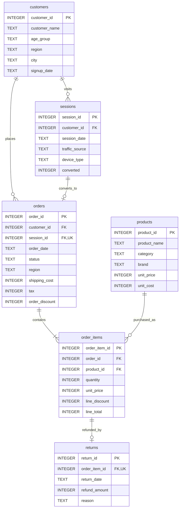

# Synthetic E-commerce warehouse

The snapshot spans 2025-05-01 through 2026-10-31. Exclusive AS_OF_DATE is frozen
at 2026-11-01 in app/config.py; the host clock is never consulted. Dates are ISO
calendar dates and periods have inclusive starts and exclusive ends. Seed:
20261101. Faker names are prefixed Synthetic; no real customer source, email,
telephone or street address is used. Cities and brands are invented labels.

## Grain and amounts

All money is integer **USD cents**, including prices, costs, totals, discounts,
tax, shipping and refunds. Divide aggregate cents by 100 only for USD display.
Quantities are units; discounts are absolute amounts, not percentages.

| Relation | Grain | Seeded rows |
|---|---|---:|
| customers | One customer | 160 |
| products | One product with fixed snapshot price/cost | 72 |
| sessions | One identified customer's visit | 2,400 |
| orders | One submitted order | 400 |
| order_items | One product line within an order | 580 |
| returns | One partial/full line refund, at most one per line | 43 |
| commerce_lines (view) | Exactly one row per order_item_id | 580 |

**Line-level:** quantity, unit_price, line_discount, line_total. The invariant is
`line_total = quantity * unit_price - line_discount`. Line unit_price is the sale
price snapshot, independent of future product list-price changes.

**Order-level:** shipping_cost, tax, order_discount. Joining an order to multiple
lines repeats these values. Never SUM raw order-level amounts over that join.
COUNT(*) on order_items is order_lines, COUNT(DISTINCT order_id) is orders, and
SUM(quantity) is units_sold. These measures are deliberately distinct.

## Revenue and allocation

Recognized sales use completed and returned orders, excluding pending and
cancelled. Returned orders retain their original sales and subtract actual
refunds. Shipping and tax never enter merchandise revenue, AOV or margin.

commerce_lines aggregates returns by order_item_id before joining unique order
and product targets. It apportions each order_discount proportionally to line
post-line-discount line_total using integer division. Each line receives its
floor allocation; remaining cents go to the smallest order_item_id. Allocations
sum exactly to the original order_discount. Generated order subtotals are
positive and discounts modest. Lines retain all original line amounts.

| Metric | How it avoids fan-out |
|---|---|
| Gross revenue | SUM(quantity * unit_price) once per eligible line |
| Discounts / discount rate | Line discounts plus allocated order discounts; ratio of sums |
| Net revenue | Gross minus line discounts, allocated order discounts and preaggregated refunds |
| Refunds | One aggregate refund per line; attributed to original order date |
| AOV | Aggregate net revenue, then divide by distinct eligible orders |
| Gross margin | Net revenue minus quantity * unit_cost once per eligible line |
| Order lines / units sold / return rate | Line grain and joins only to unique targets |
| Orders / cancellation rate | Order grain with no line joins |
| New customers | Customer signup grain; no orders join |
| Repeat purchase rate | Aggregate orders per customer before counting repeat purchasers |
| Conversion rate | Session grain; converted flag, no order join |

Gross margin is absolute USD. Returned stock has no COGS recovery in this model;
refund amounts do not imply returned quantities. Seeded refunds do not exceed
the post-order-discount proceeds of their line. All seeded refunds predate the
frozen snapshot cutoff. Arbitrary historical refund snapshots are future work.

## Integrity and indexes

Every table has an integer PK and declared FKs. A composite order-to-session FK
also enforces the same customer, and order.session_id is unique. Tests check
one real order for every converted session, at least one line per order,
date consistency and no orphan keys. Converted-session correspondence is
maintained by generation/tests rather than a cyclic database constraint.

CHECK constraints enforce the four statuses, positive quantity, nonnegative
amounts and line arithmetic. Refund INSERT/UPDATE triggers and a line UPDATE
trigger prevent refund_amount exceeding line_total. A unique line key allows
at most one return per line. Tests exercise actual failed writes in disposable
copies. Indexes cover FK paths, signup dates, session dates, order date/status
and return dates; PK and UNIQUE constraints provide additional indexes.

November/December visits receive higher sampling weights, with a smaller July
increase. Orders sample sessions and preserve seasonal traffic patterns. Some
order shipping regions intentionally differ from customer profile regions.

## Dimension safety and time

Order lines reach orders, products, customers and sessions only through FK paths
with individually unique targets. Orders reach customers and their one session;
sessions reach customers. No reverse path into order lines is approved for
order/session/customer metrics. Category and brand are line-only dimensions.

Month and quarter transform base dates without joining a calendar table:
order_date for lines/orders, session_date for sessions, signup_date for customers.
Month is YYYY-MM and calendar quarter is YYYY-Qn. Repeat purchase rate counts
orders within each requested period, rather than lifetime cohort purchases.
Distinct-customer counts and ratios are not additive across dimension groups.

The loader checks FK and unique-key metadata. Tests execute every permitted
metric-dimension join and verify unchanged row counts. The request compiler
deduplicates shared join edges and scopes the existing catalog formulas to
approved fact IDs. See docs/02-architecture.md for the implemented pipeline.
