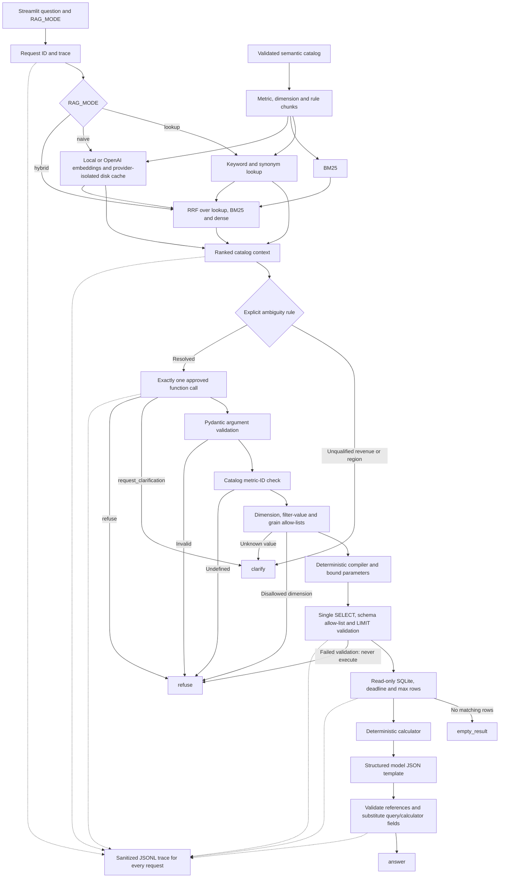

# Question-to-answer architecture

The request path operates on the existing immutable warehouse and governed
catalog. Retrieval indexes catalog definitions, dimensions, synonyms, examples
and business rules only. Customer, product, session and order rows never enter
the retrieval corpus. This document describes lookup/naive/hybrid; the optional
hybrid_rerank and corrective paths are documented in docs/03-architecture-corrective.md.



The diagram shows possible routes; each request runs exactly its configured
retrievers. Naive does not use keyword fallback. Hybrid uses reciprocal-rank
fusion of independent lookup, BM25 and dense results, without an extra scorer.

## Modules and interfaces

| Module | Interface and contract |
|---|---|
| app/config.py | Settings and load_settings(); no credentials stored in settings |
| app/retrieval/chunks.py | chunk_catalog(Catalog) -> list[Chunk] |
| app/retrieval/lexical.py | LookupRetriever.search(), BM25Retriever.search() |
| app/retrieval/dense.py | EmbeddingProvider.embed(); DenseRetriever.search() |
| app/retrieval/providers.py | create_embedder(); LocalEmbedder / OpenAIEmbedder; cached load_local_model() |
| app/retrieval/fusion.py | rrf(retriever_results, k, constant=60) -> list[Hit] |
| app/retrieval/engine.py | search(question, mode, k) -> list[Hit] |
| app/llm/schemas.py | SelectMetric, RequestClarification, Refuse |
| app/llm/client.py | LanguageModel.select() -> ToolCall; answer() -> AnswerTemplate |
| app/semantic/policy.py | metric_exists(); validate_request() -> ValidatedRequest |
| app/semantic/dates.py | resolve_dates() -> inclusive start, exclusive end |
| app/sql/compiler.py | compile_request() -> SQL and parameter dictionary |
| app/sql/validation.py | validate_query() -> None, or failure before execution |
| app/db/executor.py | execute_query() -> bounded structured rows |
| app/answers/ | calculate(), per_order(), percentage_change(), render() |
| app/observability/trace.py | Trace.step(), Trace.save() |
| app/service.py | MetricsService.ask(question) -> PipelineResponse |
| ui/streamlit_app.py | main(): questions, mode, outcomes and trace inspection |

## Retrieval and cache behavior

Metric chunks include names, synonyms, descriptions, allowed dimensions, business
rules and example questions. Examples default to deterministic governed-question
templates when the catalog does not author custom examples. Dimension chunks
include descriptions and supported base tables. Identical rule text is deduplicated,
retaining affected metric IDs; ambiguity rules are separate rule chunks.

Lookup prioritizes exact/synonym phrases, then keyword overlap. BM25 uses Okapi
k1=1.5 and b=0.75. Dense retrieval uses cosine similarity of the selected provider's embeddings.
Hybrid retrieves a deeper candidate pool per retriever and sums 1/(60+rank).
Ties are resolved by stable chunk ID. Hits preserve all contributing ranks and
original scores; fusion score is separate from original scores.

Embedding files are addressed by cache version, provider, model and text SHA-256. Both
corpus and question vectors are cached. Files contain vectors, not raw questions
or data rows. New provider/text/model invalidates its cache entry; atomic replacement
avoids partially written cache files. The v2 namespace never reads legacy v1
OpenAI vector files. Cache files, downloaded weights and traces are git-ignored.

EMBEDDING_PROVIDER defaults to local, with sentence-transformers/all-MiniLM-L6-v2.
Local inference runs on CPU without API credentials. The first run downloads
public weights to data/models/; a network connection is needed only to obtain
uncached weights. load_local_model() is decorated with st.cache_resource and
reuses one model per model name/cache directory across service/UI reruns. A shared
lock serializes encode calls across sessions. Remote code and authentication are
disabled for loading the public local model.

EMBEDDING_PROVIDER=openai uses the existing lazy OpenAI adapter and requires
environment credentials and project access on embedding cache misses. The
OPENAI_EMBEDDING_MODEL variable is deliberately retained for either provider:
its default is MiniLM for local and text-embedding-3-small for openai. When
switching providers, clear it to use the provider default or set a matching model.
Neither adapter silently calls the other. Provider failures become safe refusals
naming EMBEDDING_PROVIDER / OPENAI_EMBEDDING_MODEL (and OPENAI_API_KEY for OpenAI).
Local inference and cache hits consume zero API tokens; OpenAI reports its usage.

## Function calling and safety chain

Only three functions are exposed to selection:

- select_metric(metric_id, dimensions, filters, time_range, grain).
- request_clarification(options).
- refuse(reason).

The OpenAI adapter generates strict tool schemas from Pydantic and requires
exactly one function call with parallel calls disabled. Raw arguments remain
untrusted until the independent local Pydantic validation step. Neither the model
nor any function receives an SQL execution tool. Reviewed SQL formulas stay out
of selection prompts; the model sees definitions and business rules.

Selection and JSON answer generation use the Responses API with store=false.
This preserves the configured model, including models whose reasoning-enabled
function calling is not supported on Chat Completions.

Safety layers run in order:

1. Structural validation rejects unknown fields, malformed dates/filters and
   unsupported operators. Filters support eq or in over bounded lists of strings.
2. An exact catalog-ID lookup rejects undefined metrics.
3. Metric-specific dimensions and grains are checked; only approved dimensions
   may be filtered. Status is available only for order/line metrics. Governed
   categorical values live in app/semantic/policy.py; month/quarter values must
   match calendar formats. Unknown values clarify; disallowed identifiers refuse.
4. Compiler rechecks policy, then uses catalog formulas and metadata only. Values
   are bound parameters; user strings never become identifiers or SQL fragments.
5. SQLGlot rejects comments, multi-statements, non-SELECT roots, external tables,
   table-valued functions, unknown functions, PRAGMA, ATTACH, DDL/DML and unapproved
   columns. Scope-aware column qualification checks CTEs and subqueries against
   a reviewed schema. CTEs cannot shadow governed relations. A literal root LIMIT
   is mandatory and bounded. OFFSET is rejected.
6. Executor revalidates SQL before opening SQLite, uses URI mode=ro and
   PRAGMA query_only=ON, a connection timeout, a progress-handler deadline and a
   fetch cap. Validation failure cannot reach connection creation/execution.

Unknown natural-language intent still depends on the selector choosing a valid
function. The local chain independently rejects undefined IDs and unsupported
arguments, but does not claim to prove that a valid model-selected metric matches
every possible question. Explicit catalog ambiguities are enforced before the
selector so those cannot be guessed even by an incorrect model.

## Compiler semantics and grain

The compiler builds a materialized scope of approved base fact IDs with safe
many-to-one dimension joins, time bounds, default filters and bound user filters.
Shared join edges are deduplicated. Groups select fact IDs from that scope and
evaluate the existing catalog formula at each group; the compiler does not invent
new financial expressions. Repeated and ratio subqueries receive the same scope.

The commerce_lines view is materialized once per request when needed, preserving
the cent-exact order-discount allocation across all lines before category filters.
It is never recomputed on a category-filtered partial order. AOV scopes line
numerators by order IDs and counts distinct eligible orders; repeat purchase rate
recounts customers within each selected period/group. Ratios are recomputed, not
averaged across groups. See docs/01-data-model.md for monetary and grain rules.

Source row count distinguishes an empty valid scope from a real zero result.
No base rows or a NULL zero-denominator ratio produces empty_result. Real zero
metrics with matching source rows remain answer. Results are ordered by dimension
keys and limited to the configured cap (default 100, absolute maximum 500).
Returned group shares are explicitly shares of visible groups, not a hidden total.

## Date semantics

AS_OF_DATE remains 2026-11-01. Supported relative names are all_time, this_month,
last_month, this_quarter, last_quarter, this_year, last_year and last_30_days.
Bounds are inclusive/exclusive and clipped to the frozen snapshot. At this cutoff,
this_month is an empty range. All_time starts at 1900-01-01; future valid ranges
return empty results. Arbitrary date language is resolved by function calling to
one of these names or explicit ISO bounds, then checked locally.

Refunds remain attributed to original order date using the frozen snapshot;
earlier order-date ranges do not reconstruct what refunds were known historically.
No additional historical-as-of claim is made.

## Answers and numeric provenance

Each outcome contains outcome, value, metric_definition, sql and trace_id, keeping
nullable fields present. Pipeline responses also carry rows, bound parameters,
calculations, retrieved chunks, template source, timeline and latency.

The answer model receives structured results and named calculator outputs, never
an instruction to perform arithmetic. Its strict JSON response is {template: ...}.
Templates may use only known {{result.field}} and {{calc.name}} references for
numeric facts. The renderer rejects raw digits, Unicode numeric literals, common
spelled-out numbers, malformed references and unknown fields. It never evaluates
expressions. Valid references substitute values from query results/application
code only. Model output failure uses a deterministic reference template without
another retrieval or SQL attempt.

Calculator operations use Decimal inputs constructed from query values. AOV
exposes numerator/denominator as internal SQL outputs, then computes calc.per_order
in application code; these auxiliary columns are hidden from displayed rows.
Ratios expose percentage outputs. Additive grouped metrics expose visible share
percentages. Time series expose change since the previous observed period within
the same other-dimension group; missing periods are not imputed. Independent
multi-metric comparisons are outside this single-metric function contract.

Rendering prevents fabricated numeric literals; it does not prove all prose is
semantically faithful or eliminate precision already present in SQLite results.
Templates cannot introduce calculations that are absent from calculator outputs.

## Observability and operations

Each request receives a UUID. Executed steps record start offset, latency, status
and tokens, with retrieval candidates/top metric/ranks/scores, function arguments,
validation outcomes, SQL/parameters and DB row count where relevant. Early exits
terminate the timeline before unexecuted steps. Local steps have zero token use;
provider steps record reported counts. Provider failures may have unavailable
usage, represented by an empty token map. Exception text is not logged.

Credential redaction is also applied before questions reach retrieval or the
model. Known environment secrets and credential patterns are not forwarded in
question text.

data/traces/requests.jsonl has one sanitized record per request, containing all
step events. Known environment secrets, credential fields and key-like patterns
are recursively redacted. Cached embeddings and traces are local and git-ignored.
Questions are stored after credential redaction, so arbitrary sensitive prose
should not be entered. Trace writes use a process-local thread lock; this local
Streamlit deployment does not claim distributed log coordination.

The UI displays question, mode, outcome, value, metric definition, SQL/parameters,
retrieved chunks and scores, trace timeline, request ID and total latency. Changing
mode affects the next submission; existing results remain labeled by their trace.

## Running and testing

```powershell
.\.venv\Scripts\python.exe -m pip install -r requirements-dev.txt
.\.venv\Scripts\python.exe -m streamlit run app.py
.\.venv\Scripts\python.exe -m pytest --basetemp=.pytest-tmp -q
```

Populate the ignored .env with OPENAI_API_KEY and optionally OPENAI_MODEL,
EMBEDDING_PROVIDER, OPENAI_EMBEDDING_MODEL and RAG_MODE. The committed .env.example
contains only empty values; blank values use application defaults. Credentials
come only from environment after dotenv loading; no key is displayed or stored
in settings. The default mode is hybrid with local embeddings. Missing LLM
credentials still fail safely during selection; local retrieval itself needs no
key. No simulated model or alternate retriever is substituted in the running app.

The earlier live lookup verification passed through function calling, SQLite and
template rendering. OpenAI embeddings were denied for the configured project;
the default local provider removes that dependency for naive/hybrid retrieval.
Local model downloads and network calls are excluded from automated tests:
stub embedders prove provider selection, resource reuse, safe failures and cache
isolation. Local weights have not been downloaded by the tests.

Tests use real SQLite with independent synthetic fixtures, mocked model/embedding
clients, actual SDK serialization via mock HTTP, and Streamlit AppTest. They cover
every safety layer, injection values, forged requests, empty/clarify/refuse/answer,
grouped financial reconciliation, retrieval caches/modes/RRF, answer provenance,
trace redaction and UI submission. Locked evaluation data is not used for tuning.

## Official API references

- [OpenAI function calling](https://developers.openai.com/api/docs/guides/function-calling)
- [OpenAI structured outputs](https://developers.openai.com/api/docs/guides/structured-outputs)
- [OpenAI embeddings](https://developers.openai.com/api/docs/guides/embeddings)
- [GPT-6 Luna API compatibility](https://developers.openai.com/api/docs/models/gpt-6-luna)
- [SentenceTransformer loading and encoding](https://sbert.net/docs/package_reference/sentence_transformer/model.html)
- [all-MiniLM-L6-v2 model card](https://huggingface.co/sentence-transformers/all-MiniLM-L6-v2)
