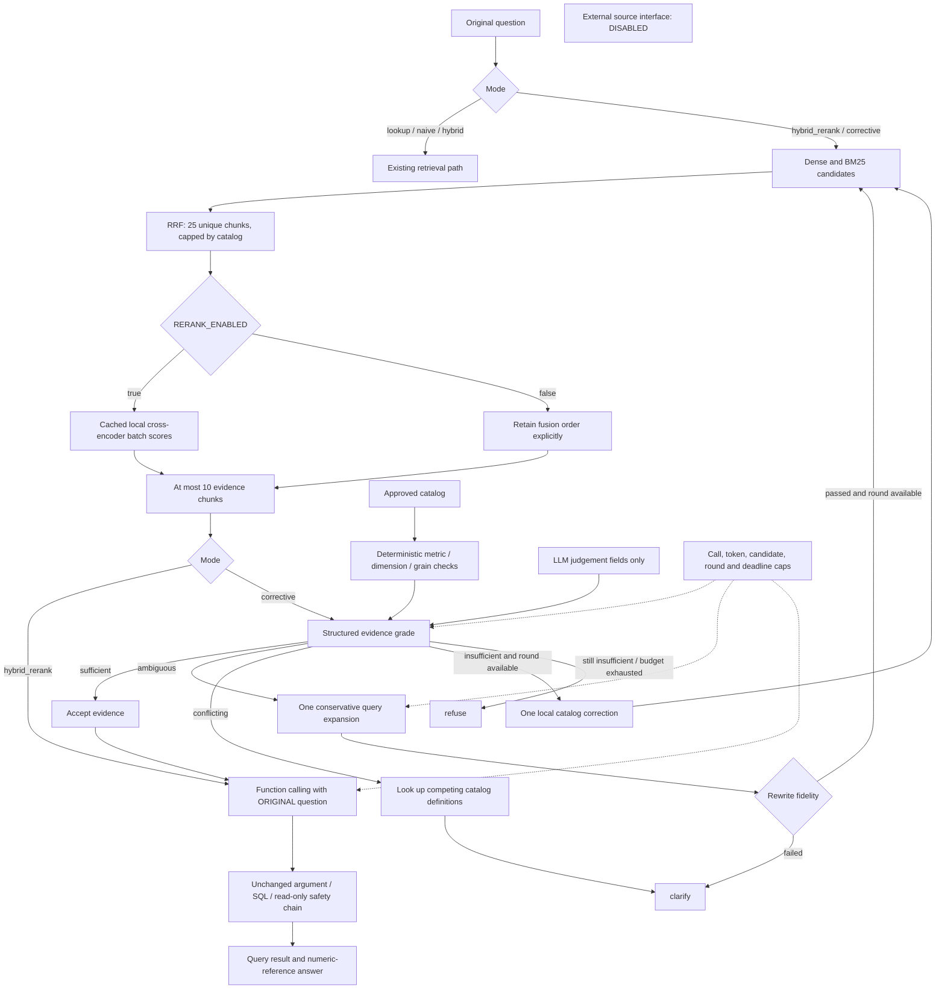

# Reranked Corrective RAG

This document records the preceding retrieval phase. The full 77-question
evaluation and split gates are now described in [04-evaluation.md](04-evaluation.md).

This phase preserves lookup, naive and hybrid and adds hybrid_rerank and
corrective. The catalog is the only evidence source. No warehouse rows, web
pages or external definitions enter retrieval or correction. The locked split
was neither read nor tuned on. The full development set remains future work;
eval/dev_smoke.yaml is a temporary 18-question development diagnostic, never a
locked test set.

## Retrieval versus reranking

Retrieval finds a manageable evidence pool. Existing hybrid continues to fuse
lookup, BM25 and dense results exactly as before. The two new modes use dense
and BM25 only, followed by RRF, retaining 20–30 unique candidate IDs (default 25,
or the entire catalog when smaller). Internal retriever search depth is capped
by catalog size; only the configured pool proceeds to pair scoring.

Reranking evaluates the question and each candidate text jointly with a local
Sentence Transformer CrossEncoder, default cross-encoder/ms-marco-MiniLM-L6-v2.
Unlike embedding similarity, it cannot precompute a document-only score. Pair
scores are cached by model, question hash and chunk-text hash. All cache misses
are batch-scored, while original BM25/dense/RRF ranks and scores remain visible.
The top ten go to evidence selection. The model is cached with st.cache_resource
and CPU inference is serialized. No API key or extra package is required beyond
the existing sentence-transformers dependency. Public weights may download once.

RERANK_ENABLED=false deliberately bypasses pair scoring and retains fusion order.
An enabled but unavailable reranker refuses with a message naming RERANK_MODEL
or RERANK_ENABLED; there is no automatic substitution.

## Structured grading and deterministic checks

app/retrieval/evidence.py defines strict Pydantic schemas. Judgement contains
only verdict, confidence, missing_aspects and conflicts. Verdict is an enum:
sufficient, ambiguous, conflicting or insufficient. Unexpected fields and
free-text verdicts are rejected. The model cannot output the catalog booleans.

EvidenceGrade combines those fields with locally computed metric_found,
dimension_allowed, time_grain_valid, metric_id and next_action. Metric names and
synonyms are matched conservatively against the catalog, then the actual metric
definition must be present in evidence. Dimensions and grains are checked
against that definition's lists. Daily/weekly/hourly/yearly grouping is not
silently converted to supported month/quarter grouping. An optimistic model
cannot override a failed check or a deterministic revenue/region ambiguity.

Catalog-proven ambiguity/conflict or failed catalog checks are graded locally
without paying for model judgement. Otherwise the Responses API supplies only
judgement fields using a strict JSON schema. Low confidence (default below 0.65)
prevents accepting an otherwise sufficient verdict. No grades are read from
free-form prose. Function selection, Pydantic arguments, policy, deterministic
SQL compilation, AST validation and bounded read-only execution remain required
after evidence acceptance.

The selected metric must also match the deterministic metric ID in the accepted
grade. A selector cannot substitute another valid catalog metric after grading.

Matching is conservative and is not a universal natural-language parser. Unseen
paraphrases without recognized aliases may abstain even when a human could map
them to a catalog metric. The smoke run does not establish grader calibration.

## Bounded correction and fidelity

There are at most two retrieval rounds: the initial round and one retry.
Sufficient evidence proceeds. Conflicting definitions are fetched by catalog ID
and cause clarification; gross and net revenue are never arbitrarily chosen.
Insufficient evidence triggers one approved-catalog correction that adds the
explicit metric definition, requested dimensions and associated business rules
to the next bounded pool. A second insufficient grade abstains with refuse.

Ambiguous evidence can trigger one model-proposed retrieval query expansion.
The original question must remain an exact verbatim prefix; appended text may
contain only synonyms of its explicitly named metric. Number/date/currency/unit
and negation occurrences must remain unchanged, as must metric/dimension intent.
Arbitrary punctuation, SQL-like suffixes, new dates/units or scope changes fail.
This intentionally supports conservative expansion rather than arbitrary
paraphrasing. Failed rewrites clarify. The original question ALWAYS reaches
function calling, regardless of the retrieval query, so expansion cannot replace
the user's instruction.

Only one rewrite OR correction retry is available. app/retrieval/external.py
defines a future source protocol but its implementation unconditionally rejects
requests. Settings.external_sources_enabled is Literal[False]. No external
fetching is wired into the controller.

## Config and API budget

All new .env.example values are empty; blank values use these defaults:

| Setting | Default | Hard range / meaning |
|---|---|---|
| RAG_MODE | hybrid | lookup, naive, hybrid, hybrid_rerank, corrective |
| RERANK_ENABLED | true | false bypasses scoring explicitly |
| RERANK_MODEL | cross-encoder/ms-marco-MiniLM-L6-v2 | local model ID |
| CANDIDATE_K | 25 | 20–30, capped by catalog size |
| EVIDENCE_K | 10 | 1–10 |
| RERANK_BATCH_SIZE | 16 | 1–32 |
| MAX_RETRIEVAL_ROUNDS | 2 | 1–2 |
| MAX_LLM_CALLS | 4 | 1–6 attempted text-generation requests |
| MAX_OUTPUT_TOKENS | 6000 | total reserved maximum output across calls |
| SELECT_TOKENS | 2000 | per-selection maximum |
| ANSWER_TOKENS | 1200 | per-answer maximum |
| GRADE_TOKENS | 1200 | per-judgement maximum |
| REWRITE_TOKENS | 500 | per-rewrite maximum |
| MAX_PROMPT_BYTES | 24000 | serialized request size, not an estimated token count |
| RETRIEVAL_TIMEOUT | 30 seconds | bounded retrieval waiting |
| RERANK_TIMEOUT | 30 seconds | bounded pair scoring/model-load waiting |
| REQUEST_TIMEOUT | 120 seconds | overall monotonic request deadline |
| EVIDENCE_CONFIDENCE | 0.65 | minimum accepting confidence |

CallBudget reserves a call and its maximum output BEFORE invoking the model,
including failed/invalid outputs. Provider retries are disabled. Selection,
grading, rewriting and answer generation share the same counter. A typical
sufficient corrective request needs three calls; correction may use four. A
rewrite route can exhaust the cap before prose generation, in which case the
existing deterministic numeric-reference template renders query results without
another model call. Exhaustion before selection abstains and never executes SQL.
Bounds apply to existing modes as well. Local model inference is not an LLM API
call; OpenAI embedding requests, if deliberately configured, are separate API
usage and not counted as text-generation calls. Local embeddings are the default.

HTTP timeouts use remaining request time. Candidate retrieval and local pair
scoring use bounded single-worker executors and a one-job admission slot. A
timed-out native CPU/download operation may finish in the background; its results
are not accepted and new jobs cannot queue behind it. This is bounded response
waiting, not unsafe thread cancellation. SQL retains its independent deadline.

## Traces and UI

The existing request trace adds retrieval, reranking, evidence_selection,
grading, rewriting, correction, correction_retrieval and final_decision events.
It includes candidates, per-retriever scores, pair scores, grades, approved local
targets, fidelity results and decisions. Errors log safe types, not secret-bearing
exception messages. A final abstention is recorded when a later budget/policy
failure prevents an earlier proceed decision from reaching an answer.

PipelineResponse exposes crag_path, evidence_grades, model_calls and
output_token_reservation. Streamlit offers five modes and shows the path and
grades within the trace timeline. All startup work remains lazy and visible.

## Evaluation boundaries

Before upgrading retrieval, scripts/evaluate_smoke.py froze the original-mode
results in eval/dev_smoke_baseline.json. It used real local MiniLM retrieval and
zero OpenAI calls. Metric recall@6 and truncated reciprocal rank are retrieval
measurements on metric-labeled cases. Separately, canonical/oracle function
arguments replayed the SQL safety pipeline for all four outcomes. That replay
is explicitly NOT LLM selection, grader quality or end-to-end answer accuracy.

The upgraded run uses the same set and actual local cross-encoder for pair
scores, with the same oracle replay and catalog-check judgement replay. It makes
zero OpenAI calls. Do not use its outcome agreement to claim production semantic
quality. See docs/04-dev-smoke-comparison.md for measured results and regressions.
No thresholds, prompts or model weights were tuned to force a smoke-set win.
The original hybrid remains default. Full dev and locked evaluations are future
work; this smoke set must never be promoted to locked tests.

A separate live grader/schema check used a hard one-call cap. It returned a
valid sufficient grade; the cap then intentionally blocked function selection
and no SQL executed. That is a budget/schema verification, not an end-to-end
accuracy result, and it is not included in the zero-call comparison totals.

## References

- [Sentence Transformers CrossEncoder](https://sbert.net/docs/package_reference/cross_encoder/model.html)
- [Default local reranker model](https://huggingface.co/cross-encoder/ms-marco-MiniLM-L6-v2)
- [OpenAI structured output schemas](https://developers.openai.com/api/docs/guides/structured-outputs)
