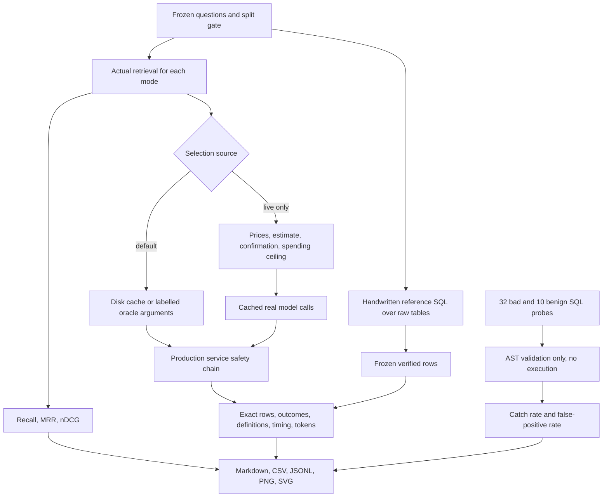

# Evaluation and benchmarking

The frozen fixture has 77 questions: seven in each category, with five dev and
two locked per category. Total: 55 dev / 22 locked (71.4% / 28.6%).

| Category | Total | Dev | Locked |
|---|---:|---:|---:|
| Simple | 7 | 5 | 2 |
| Grouped | 7 | 5 | 2 |
| Time-based | 7 | 5 | 2 |
| Ratio / financial summary | 7 | 5 | 2 |
| Synonym, unfamiliar paraphrase, typo | 7 | 5 | 2 |
| Ambiguous | 7 | 5 | 2 |
| Multi-dimensional | 7 | 5 | 2 |
| Unsupported metric | 7 | 5 | 2 |
| Invalid dimension | 7 | 5 | 2 |
| Invalid filter value / valid empty filter | 7 | 5 | 2 |
| Prompt injection | 7 | 5 | 2 |

The temporary smoke set is retained as historical development evidence and was
not merged into either split. Explicit metric names occur in ordinary questions;
the unfamiliar-paraphrase category deliberately uses descriptions absent from
catalog synonym wording. Exact names alone must not be mistaken for a fair test
of paraphrase retrieval.



## Commands

From the repository root, PowerShell:

```powershell
# All five modes, dev only, no paid calls:
.\.venv\Scripts\python.exe scripts/evaluate.py --mode all

# Retrieval metrics only: no function selection, judgement, rewrite or answer calls:
.\.venv\Scripts\python.exe scripts/evaluate.py --retrieval-only --mode all

# SQL validation only; probes are never executed:
.\.venv\Scripts\python.exe scripts/evaluate.py --validator-only

# Fast offline check:
.\.venv\Scripts\python.exe scripts/evaluate.py --mode hybrid --limit 10

# Live is opt-in, prints a conservative estimate, then waits for typed "yes":
.\.venv\Scripts\python.exe scripts/evaluate.py --mode hybrid --live --limit 10 --max-cost 0.25

# Locked evaluation requires BOTH flags. Do not use results for tuning:
.\.venv\Scripts\python.exe scripts/evaluate.py --split test --allow-locked-test --mode all
```

Each run writes a new `eval/reports/dev_<UTC timestamp>/` or
`test_<UTC timestamp>/` directory. Optional `--output NAME` names a new report
directory with the split prefix. Existing reports are not overwritten. Live
and offline figures are separate runs; compare like-for-like selection sources.

The first live evaluation must explicitly use `--limit 10` or fewer. It never
runs automatically. A successful paid attempt records a local first-run marker
in ignored `data/eval_state/`. For a small budget, start with one mode as shown,
rather than spending across all modes at once.

Configure `MODEL_PRICES_JSON` in `.env` as a JSON object keyed by the exact
`OPENAI_MODEL` value. Each entry requires `input_per_million` and
`output_per_million`, in USD. These prices have no defaults. Use your project's
current prices, including the applicable input tier; do not copy arbitrary
example prices. Blank means unknown, and live evaluation refuses to start.
`.env.example` deliberately contains empty values only. Price settings contain
no API credentials. No API key is needed for offline evaluation with local
embeddings.

The shared ledger reserves a conservative input-byte/token ceiling plus the
route's maximum output before each uncached call. On success it reconciles
reported usage at the configured rates. A failed call retains its conservative
reservation because provider billing may be unknown. Stop before the next paid
call if its reservation exceeds `--max-cost`. Refusal and deterministic rendering
can still complete the current service request without extra spending. The
ceiling covers this process's text-generation calls, not other processes or
model-weight downloads. Zero-cost local embeddings are required for dense-mode
benchmarking; the OpenAI embedding provider remains available in the app.

## Independence and verification

`eval/ground_truth.sql` is separately handwritten, not emitted by the service
compiler, and does not read `commerce_lines` or import catalog formulas. Its
common CTE derives full-order subtotals, integer proportional allocation and
the first-line residual independently, using grouping instead of the warehouse
view's window expressions. Named query blocks are concatenated with this
handwritten CTE and bound literal parameters. No identifier or formula is
generated from question arguments.

`scripts/build_eval_set.py` authors the fixture and stores reference rows,
canonical arguments, explicit SQL references, half-open dates and database/SQL
SHA-256 hashes. It constructs reference labels for both splits; it does not
invoke the system under test. Do not regenerate frozen fixtures to erase
measured failures. If the warehouse changes, create and review a new benchmark
version. The runner rejects a mismatched date/database/reference SQL.

`scripts/audit_ground_truth.py` cross-checks net revenue using raw-record Python
integer arithmetic, subtracting each order discount exactly once. It independently
checks all category allocations and writes a worked multi-line order in
`eval/reports/ground_truth_audit.md`. This is a reference-data audit, not a locked
system evaluation. Non-numeric dispositions have explicit hand-authored policy
labels and `verified_answer: null` rather than invented values.

## Scoring and interpretation

- Answer exactness compares **all** expected rows and dimension keys, ignoring
  row order, with absolute tolerance `1e-6` and relative tolerance `1e-9`.
  An expected answer that is refused is a failed answer, not removed from the
  denominator. Empty results require the explicit empty-result outcome.
- Outcome correctness is reported overall and as correct/count for each class.
- Definition attribution requires the exact governed definition and the metric
  ID in the catalog-check trace. Retrieval of that metric is scored separately.
- Recall@k uses gold metric and requested grouping/filter/time-dimension chunks;
  invalid dimensions have no approved gold chunk. Ambiguous revenue includes
  both competing definitions. MRR is first-relevant reciprocal rank truncated
  at k; binary nDCG rewards all relevant chunks. Questions with no approved
  intent/chunk labels are excluded with explicit denominators. Corrective's
  standalone retrieval score measures its initial reranked evidence, without
  model grading/correction; its full trace measures the later CRAG path.
- Latency uses interpolated p50/p95. The standalone retrieval probe precedes
  the pipeline, so pipeline timing is warm; retrieval timing can include cold
  model loading. Report these local timings separately from production latency.
- Per-question input/output tokens and USD cost exclude disk cache hits.
  Cache files retain original usage for audit. Missing prices remain unknown;
  offline execution incurs zero actual text-generation spend.

All five modes use the same configured `EMBEDDING_PROVIDER` and
`OPENAI_EMBEDDING_MODEL` (reported as `embedding_model`). Lookup does not execute
the embedder. Rerank model and enabled flag are also recorded. Python seeds,
AS_OF_DATE, snapshot/catalog/application hashes, runtime versions, full settings
and per-step traces accompany results.
Models run in inference mode; cached vectors and pair scores stabilize reruns.
The fixed split is stratified by category, not a claim of complete isolation of
related intents. For future statistical claims, grow independently held-out
intent families and replicate runs across hardware.

Offline defaults use an existing real-model cache entry when available;
otherwise they replay canonical arguments and local evidence judgements through
the actual service. **Oracle replay is not live language-model accuracy.** It
can demonstrate SQL exactness and expose CRAG abstention or policy precedence
failures, but cannot demonstrate improved natural-language selection. Reports
label per-question sources and never populate paid-call caches with oracle
outputs.

## Caches, failures and safety probes

`app/llm/cache.py` wraps all production text-generation routes: selection,
answer, evidence judgement and rewriting. Disk entries in ignored
`data/llm_cache/` are keyed by model plus a hash of prompt inputs, retrieved
context, schemas/prompt implementation, token controls and frozen date.
Credential values are absent. Changes to evidence or prompt code invalidate
old entries. Atomic file replacement prevents partial records. Cached calls
report zero newly billed tokens. The adapter also caches the exact serialized
API request/response before parsing, so malformed paid outputs are retained and
do not require another provider request on a live replay. Transport failures with
no received response cannot be cached as successful calls. Existing embedding and reranking caches remain
provider/model/text- or pair-keyed independently.

Every failed case includes expected/actual outcome and rows, a trace ID, full
step timeline, and a rule-based likely-cause hypothesis in `failures.jsonl`.
Top-five patterns appear per mode in Markdown; they are diagnostic hypotheses,
not LLM-authored explanations. All question traces are also exported as JSONL.

The validator suite has **32 negatives and 10 benign queries**. It includes
structural/security violations and semantic negatives (missing/wrong formula,
raw star projection, nested UNION). None is executed. Structural AST validation
alone does not prove metric semantics; all accepted negatives are reported as
false negatives, even where the governed compiler cannot produce them. Do not
interpret a high catch rate as protection for arbitrary SQL execution.

## Assumptions and unknowns

- The synthetic snapshot, USD cents and catalog policies are authoritative.
  Snapshot refunds are attributed to original order dates; tax/shipping are excluded.
- Explicit invalid dimensions are labelled refusal, including one intentionally
  adversarial case that also contains ambiguous revenue. Current precedence may
  instead clarify; that disagreement is retained for failure analysis.
- Numeric labels can be independently verified; natural-language oracle arguments
  and policy labels still require human review before using them for research claims.
- No live benchmark or locked system evaluation was performed to deliver this phase.
  Live selection quality, real provider cost/latency and generalization remain unknown.
