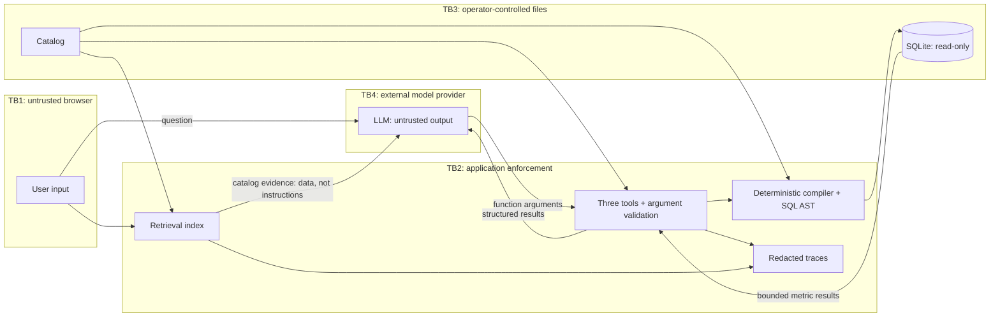

# Security review — 2026-11-13

Scope: current project files and installed environment; no Git history, locked
evaluation or live LLM calls. Assumption: operators control code, catalog and
model/cache directories; this is a local synthetic-data prototype.

Top threats: prompt/tool/SQL injection; credential or PII leakage; compromised
dependencies/local model code; repeated requests exhausting CPU or API budget.

## Findings and disposition

| Severity | Evidence (file:line) | Finding / status |
|---|---|---|
| Critical | `requirements.txt:9`; `tests/test_security.py:174` | Local custom model code bypassed `trust_remote_code=False`. **Fixed:** Sentence Transformers 6.3.0. A mocked dynamic-import regression reproduced the bypass in 5.6.0 despite the advisory's version floor. |
| High | `requirements.txt:10`; `requirements.txt:2` | Pillow native memory-safety advisories. **Fixed:** Pillow 13.0.0; Streamlit 1.67.0 is required for Pillow 13 compatibility. Dependency-floor regressions added. |
| High | `app/service.py:188`; `app/llm/cache.py:134`; `app/llm/client.py:95` | Only display prose was scrubbed; templates/evidence/cache responses could retain a credential. **Fixed:** redact every public presentation field and both cache write paths; sentinel regressions cover each boundary. |
| High | `app/abuse.py:6`; `ui/streamlit_app.py:58`; `app/config.py:42` | Repeated submissions had no session admission limit. **Fixed:** sliding window, default five submissions/60 seconds, checked before model initialization; isolation/window/UI-block regressions. |
| Medium | `requirements.txt:5`; `requirements-dev.txt:2`; `eval/reports/security/pip-audit-after.json:1` | Six distinct Moderate advisories in dotenv, pytest and pip remain **unfixed as requested**. Dotenv's affected write helpers are unused; pytest advisory concerns UNIX temporary directories; pip advisories concern package installation. |
| Medium | `app/llm/client.py:124`; `app/observability/trace.py:58`; `app/llm/cache.py:130` | Retrieved context shares the selection system message; semantic injection remains possible despite tool/SQL enforcement. Question text/caches persist without retention controls. New sessions bypass session-only throttling; no distributed/authenticated quota. **Residual; unchanged.** |
| Low | `eval/reports/security/pip-audit-after.json:1`; `.gitignore:7` | One distinct Low pip traversal advisory remains. Ignore rules are not filesystem access controls; local operators still need protected credentials/cache directories. **Residual; unchanged.** |

Upstream evidence: [model-code advisory](https://github.com/advisories/GHSA-jhr6-gm9c-rqjv),
[Pillow example](https://github.com/advisories/GHSA-xcvg-w56q-r89m).
Full advisories and severities: `eval/reports/security/`.

## Verification and limits

- Secret scan covers code/config, ignored `.env`, source fixtures, logs, reports
  and JSONL traces; excludes VCS/vendor/model binaries and pytest scratch space.
  The configured credential exists **only at `.env:2`** in scanned files; no copy
  was detected elsewhere. `.gitignore:7`, `.gitignore:22`, `.gitignore:25` exclude
  dotenv, traces and caches; `.env.example:2` is empty. Values are never reported.
  No warehouse customer-name values were found outside question fields in JSONL.
  This is a known-value/pattern scan, not proof against every possible PII/secret.
- `tests/test_security.py` adds only gap regressions: direct/role/prompt/schema
  injection attempts, poisoned catalog/chunks, malicious question/filter/dimension/
  grain inputs, disclosure and admission control. Mocked adversarial outputs prove
  enforcement, **not live-model immunity**. Existing three-tool/schema tests are
  reused (`tests/test_hardening_tools.py:23`, `app/llm/schemas.py:66`).
- Actual app DB write attempts fail with query-only enabled **and after disabling
  it**, proving URI read-only independently; validator rejects the write before
  connection. DB hash stays unchanged (`tests/test_security.py:116`,
  `app/db/connection.py:9`, `app/sql/validation.py:15`).
- Existing safe UI/error/trace tests are reused (`tests/test_ui.py:32`,
  `tests/test_service.py:109`). Existing limits remain: 4,000 input characters,
  bounded rows, SQL/request/API timeouts, prompt bytes, model calls and tokens
  (`app/service.py:50`, `app/config.py:41`, `app/config.py:59`).
- Prior 574-test suite/coverage and oracle/live findings are reused, not rerun:
  `eval/reports/hardening_before_after.md`. Current targeted results, final audit
  and scanner counts are recorded in `eval/reports/security/summary.md`.

Restart Streamlit to load the patched dependencies. No Critical/High finding is
accepted as residual; Medium/Low findings above were intentionally not remediated.
